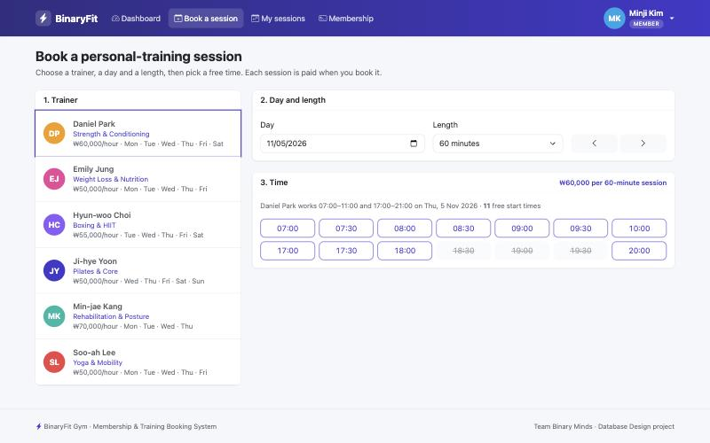
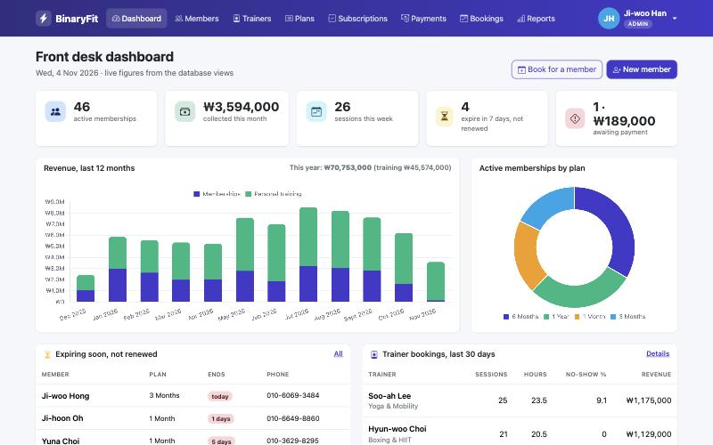
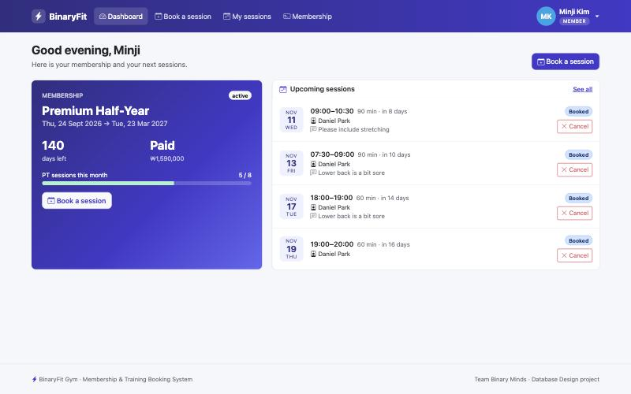
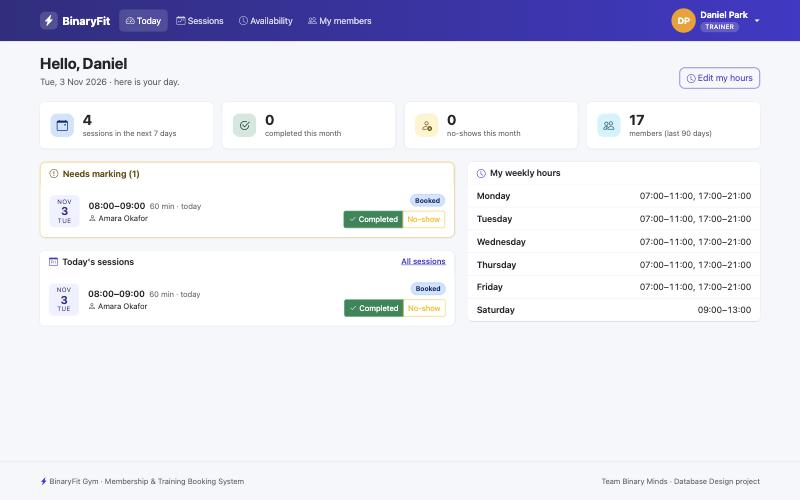
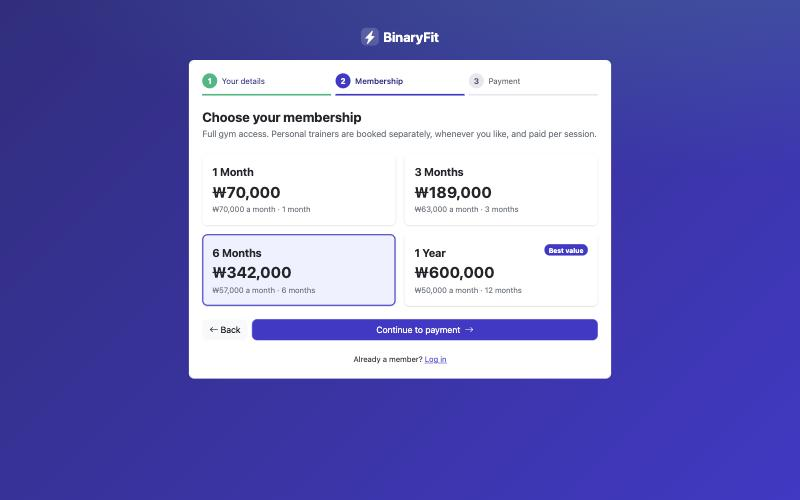

# BinaryFit Gym: Membership & Training Booking System

**Team Binary Minds**, Database Design project. Maftuna Khalimjonova · Hsu Shwe Sin Htun · Shahi Cristina · Ibrohimjon Adhamov · Jasur Abbusattarov

A web application on a MySQL database. It centralizes gym memberships, trainer availability, personal-training bookings and payments, and keeps them consistent.

- **Members** sign up in three steps (details → membership → online payment, simulated); no account exists without a paid membership. They renew online and book 1-on-1 sessions with any trainer whenever they like, **paid per session**.
- **Trainers** set their weekly hours, see their schedule and members, and mark sessions completed or no-show.
- **Admins** (front desk) enroll members (always with a paid plan), manage trainers and their hourly rates, plans, subscriptions, freezes and payments, book sessions on a member's behalf, and view management reports.
- **Social** (members and trainers): every account has a unique **@username**, checked live at sign-up. In the **Social** tab you post (with #hashtags and @mentions), like and reply, search people by @username, follow them, and open Instagram-style profiles. The feed shows people you follow first, then **Suggested for you**, ranked by what you engage with.

**Memberships are gym access only**: 1 Month ₩70,000 · 3 Months ₩189,000 · 6 Months ₩342,000 · 1 Year ₩600,000. **Personal training is separate**: each session costs the trainer's hourly rate × its length (e.g. ₩60,000/h → a 30-minute session is ₩30,000), paid when booked and refunded automatically when cancelled.

The database is normalized to **3NF (and BCNF)**. Its business rules are enforced **by MySQL itself** (triggers, CHECK and foreign keys), and the app checks them again to give friendly messages.

| Layer | Technology |
|---|---|
| Database | MySQL 8+ (developed on MySQL 26.10): tables, views, triggers |
| Backend | Node.js 24, Express 5, Sequelize 6 (mysql2), express-session (stored in MySQL), bcrypt, zod |
| Frontend | HTML5, CSS3, vanilla JavaScript modules, Bootstrap 5.3, Bootstrap Icons, Chart.js |
| Tests | Jest + Supertest (73 tests) |

| Member: book a session | Admin: dashboard |
|---|---|
|  |  |
| **Member: dashboard** | **Trainer: today** |
|  |  |
| **Sign-up: choose a membership** | |
|  | |

---

## 1. Setup (first time)

### Prerequisites
- **MySQL 8 or newer**, running locally. On this Mac it is installed in `/usr/local/mysql` and runs as a background service.
- **Node.js 20+**. On this Mac it is installed in `~/.local/node`. Add it to your PATH once by putting this line at the end of `~/.zshrc`, then open a new terminal:
  ```bash
  export PATH="$HOME/.local/node/bin:$PATH"
  ```

### Steps
```bash
cd ~/Documents/databasedesign
npm install                      # dependencies (already done on this Mac)
cp .env.example .env             # only if .env does not exist; then set DB_PASSWORD and SESSION_SECRET
./scripts/setup-mysql.sh         # once: creates gym_db, gym_test and the gym_app user (asks for the MySQL root password)
npm run db:reset                 # builds the schema, views, triggers and loads fresh demo data
npm start                        # → http://localhost:3000
```

`npm run db:reset` can be run any time to get a clean database. The demo data is generated with dates relative to *today*, so the demo always looks current.

### Demo accounts (password `Gym12345!` for all)

| Role | Email | Situation |
|---|---|---|
| Admin | `admin@binaryfit.test` | Front desk: everything, plus reports |
| Trainer | `daniel.park@binaryfit.test` | Strength coach with a full schedule |
| Member | `minji.kim@binaryfit.test` | 6-month member who trains with Daniel every week |
| Member | `sara.ahmed@binaryfit.test` | Signed up and paid online today, no sessions yet |
| Member | `joonho.lee@binaryfit.test` | Membership expired, so cannot book (R1) |
| Member | `taeyang.seo@binaryfit.test` | Gym only; his renewal awaits a bank transfer (pay it online, or "Mark paid" as admin) |
| Member | `yuna.choi@binaryfit.test` | Plan ends within a week, so shows in "Expiring soon" |
| Member | `ethan.brooks@binaryfit.test` | Membership frozen right now |

Usernames are the email's first part (for example `@minji.kim`); you can log in with either. (The login page itself does not list them.) To try the sign-up, use **Join now** with any new email.

---

## 2. Database design

| File | Contents |
|---|---|
| [`db/01_schema.sql`](db/01_schema.sql) | 16 tables with 24 foreign keys, 25 `CHECK` constraints, indexes |
| [`db/02_views.sql`](db/02_views.sql) | 10 views: derived subscription status, schedules, report views, social stats and interests |
| [`db/03_triggers.sql`](db/03_triggers.sql) | 21 triggers + 3 helper procedures enforcing rules R1–R13 |
| `db/04_seed.sql` | Generated demo data (≈60 members, 6 trainers, 5 plans, 12 months of history) |
| [`db/05_reports.sql`](db/05_reports.sql) | Management report queries (the dashboard runs these exact queries) |
| [`db/06_rule_tests.sql`](db/06_rule_tests.sql) | Live demonstration of every rule, rolled back at the end |
| [`docs/design.md`](docs/design.md) | ERD, data dictionary, business rules, concurrency |
| [`docs/normalization.md`](docs/normalization.md) | UNF → 1NF → 2NF → 3NF → BCNF walkthrough |

**Tables:** `roles`, `users`, `members`, `trainers`, `membership_plans`, `subscriptions`, `subscription_freezes`, `payments`, `trainer_availability`, `bookings`, and for the social area `follows`, `posts`, `hashtags`, `post_hashtags`, `post_likes`, `post_comments`.

### Business rules

| # | Rule | Enforced by |
|---|---|---|
| R1 | Booking a trainer needs an active, fully paid, non-frozen membership on that day | trigger (+ app) |
| R2 | A trainer is never double-booked | trigger + row lock (+ app) |
| R3 | A member is never double-booked | trigger + row lock (+ app) |
| R4 | Sessions fit inside the trainer's weekly hours | trigger (+ app) |
| R5 | A session's price comes from the trainer's hourly rate; cancelling a session refunds its payment | triggers |
| R6 | A member's subscriptions never overlap | trigger + row lock |
| R7 | Role-based access: members and trainers see only their own data | Express middleware + query scoping |
| R8 | Booking lifecycle (booked → completed / no-show / cancelled). Members cancel ≥ 12 h ahead | trigger (+ app) |
| R9 | A payment is for a membership **or** a session; it never exceeds the agreed price; valid status changes only | CHECK + trigger + row lock |
| R10 | Freezes: inside the period, no overlap, no booked sessions. Extend the end date | triggers |
| R11 | A trainer's weekly windows never overlap | trigger |
| R12 | Profiles match roles. Inactive accounts cannot book | triggers |
| R13 | Social area: only active members and trainers post, like, reply or follow; nobody follows themselves; usernames are valid and unique | triggers + CHECK + UNIQUE |

Prove them: `npm run db:check-rules` runs `db/06_rule_tests.sql` and shows all **30 rejections**.

### The social feed algorithm

"Suggested for you" ranks recent posts from people you don't follow (and that you haven't liked yet). Every signal comes from data the database already has:

| Signal | Where it comes from | Weight |
|---|---|---|
| Your interest in the post's hashtags | view `v_user_tag_interest`: reply = 3, like = 2, your own post = 1, per hashtag | 2.0 × ln(1 + score) |
| Authors you liked before | `post_likes` | 1.5 × ln(1 + likes) |
| People you follow who liked it | `post_likes` ⋈ `follows` | 1.2 each |
| A trainer you have trained with | `bookings` | + 1.5 |
| Popularity | likes and replies | 0.8 × ln(1 + likes) + 0.5 × ln(1 + replies) |

The sum is divided by an age penalty, (1 + days old)^0.6, so fresh posts win ties. Each suggestion shows why it's there ("Because you like #yoga", "@soobin liked this", "From your trainer"), and your current interests appear on the left of the feed. "Who to follow" ranks people who follow you, your trainers, friends of friends and people with the same interests. The query is in `src/services/social.js`.

### MySQL Workbench
- **ERD:** *Database → Reverse Engineer…* → connection to `127.0.0.1:3306` as `root` → select `gym_db` → Finish. Or use *File → Import → Reverse Engineer MySQL Create Script…* with `db/01_schema.sql`.
- **Reports and rule demo:** open `db/05_reports.sql` or `db/06_rule_tests.sql`, double-click `gym_db` to make it the default schema, then run statements one by one with **Ctrl+Enter**.
- Do **not** run `01_schema.sql` in Workbench on the live database: it drops the tables. Use `npm run db:reset` instead.

---

## 3. Commands

| Command | What it does |
|---|---|
| `npm start` | Starts the app on http://localhost:3000 |
| `npm run dev` | Same, restarting on file changes |
| `npm run db:reset` | Rebuilds `gym_db` and loads fresh demo data |
| `npm run db:check-rules` | Runs the business-rule demonstration and checks every rejection |
| `npm run db:seed` | Only regenerates `db/04_seed.sql` |
| `npm test` | Rebuilds `gym_test` and runs the 62 automated tests |

---

## 4. Project structure

```
db/            SQL: schema, views, triggers, seed, reports, rule demo
docs/          design.md (ERD, dictionary, rules), normalization.md
scripts/       setup-mysql.sh, reset-mysql-root.sh, db-reset.js, generate-seed.js, check-rules.js
src/
  app.js       Express app: security headers, sessions, routes, page guards
  config/      env, database (Sequelize), booking policy
  models/      Sequelize models for the 10 tables and 2 views
  middleware/  auth (login, roles, JSON-only), error mapping (trigger → HTTP 409)
  services/    bookings, subscriptions, payments, availability, users, reports
  routes/      auth, public, member, trainer, admin, reports
public/        HTML pages per role, js/ (page scripts + shared helpers), css/
tests/         Jest + Supertest
```

### How a database rule reaches the user
1. A member books a slot. The API locks the trainer and member rows and inserts the booking.
2. `trg_bookings_bi` calls `assert_booking_rules`. If the trainer is busy, it raises `SIGNAL SQLSTATE '45000' '[R2] The trainer already has a session at this time'`.
3. The error middleware turns this into `HTTP 409 { "message": "...", "rule": "R2" }`, and the page shows it in a toast.

---

## 5. Troubleshooting

| Problem | Fix |
|---|---|
| `Cannot connect to MySQL` / `ECONNREFUSED` | Start MySQL: `sudo launchctl bootstrap system /Library/LaunchDaemons/com.oracle.oss.mysql.mysqld.plist` |
| `Access denied for user 'gym_app'` | Run `./scripts/setup-mysql.sh` again |
| Forgot the MySQL root password | `./scripts/reset-mysql-root.sh` (needs your Mac password, keeps all data) |
| `command not found: npm` | Add Node to the PATH (see Prerequisites) |
| Logged out after `db:reset` | Expected: user ids are re-created, so old sessions are cleared |
