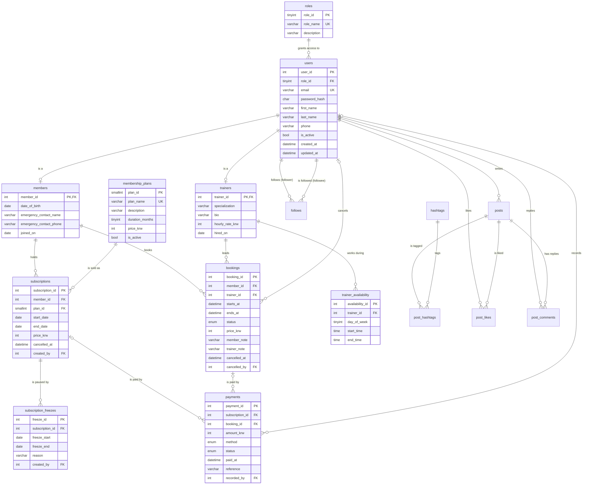

# Database Design: Gym Membership & Training Booking System

Team **Binary Minds**. This document describes the relational design behind the app: entities, the ERD, a data dictionary, the business rules, and how each rule is enforced.
The SQL source of truth is in [`db/`](../db). The normalization walkthrough is in [normalization.md](normalization.md).

## 1. Entities

| Entity | Table | Purpose |
|---|---|---|
| Role | `roles` | Lookup of access levels: admin, trainer, member |
| User | `users` | One login per person (email, bcrypt hash, name, phone, active flag) |
| Member | `members` | Member profile. **Subtype** of User (shared primary key) |
| Trainer | `trainers` | Trainer profile and hourly rate. **Subtype** of User (shared primary key) |
| Membership plan | `membership_plans` | Catalogue of gym-access plans: duration and price (personal training is not part of a plan) |
| Subscription | `subscriptions` | A member enrolled in a plan for a date range at an agreed price |
| Subscription freeze | `subscription_freezes` | A pause in a subscription. Extends its end date |
| Payment | `payments` | Money received (or attempted) for a subscription **or** a training session |
| Trainer availability | `trainer_availability` | Recurring weekly working hours of a trainer |
| Booking | `bookings` | A paid 1-on-1 training session between a member and a trainer |
| Follow | `follows` | Social: who follows whom (one direction, like Instagram) |
| Post | `posts` | Social: a short text post (≤ 280 characters) |
| Hashtag | `hashtags`, `post_hashtags` | Social: #tags parsed from posts (M:N), the basis of interests |
| Like | `post_likes` | Social: one like per person per post |
| Comment | `post_comments` | Social: replies under a post |

## 2. Entity-Relationship Diagram

**MySQL Workbench:** to get the graphical `.mwb` model, use *File → Import → Reverse Engineer MySQL Create Script…*, select `db/01_schema.sql`, then *Arrange → Autolayout*. Alternatively, use *Database → Reverse Engineer* on the live `gym_db` connection.

### Relationships and cardinalities

| Relationship | Cardinality | Notes |
|---|---|---|
| roles → users | 1 : N | Every user has exactly one role |
| users → members / trainers | 1 : 0..1 | Specialization (subtype) via shared PK. Trigger R12 checks the role matches |
| members → subscriptions | 1 : N | History kept. Periods never overlap (R6) |
| membership_plans → subscriptions | 1 : N | `ON DELETE RESTRICT`: a sold plan can be retired (`is_active = 0`) but not deleted |
| subscriptions → payments | 1 : N | Installments, failed attempts and refunds are separate rows |
| bookings → payments | 1 : N | A session is paid when booked; a cancellation refunds that payment |
| payments → subscription **or** booking | exclusive arc | `ck_payments_target`: exactly one of the two FKs is set |
| subscriptions → subscription_freezes | 1 : N | Each freeze extends `end_date` (trigger) |
| trainers → trainer_availability | 1 : N | Weekly windows. Deleted with the trainer (`CASCADE`) |
| members ↔ trainers via bookings | M : N | `bookings` is the associative entity with its own attributes |

## 3. Data dictionary

Conventions: `INT UNSIGNED` surrogate keys, `utf8mb4`, InnoDB, money in whole **KRW** (`INT UNSIGNED`, no decimals), local time (Asia/Seoul).

### roles
| Column | Type | Null | Key / Default | Description |
|---|---|---|---|---|
| role_id | TINYINT UNSIGNED | no | PK | 1 admin, 2 trainer, 3 member |
| role_name | VARCHAR(20) | no | UNIQUE | Name used by the app for authorization |
| description | VARCHAR(100) | yes | | Human-readable description |

### users
| Column | Type | Null | Key / Default | Description |
|---|---|---|---|---|
| user_id | INT UNSIGNED | no | PK, AUTO_INCREMENT | Surrogate key |
| role_id | TINYINT UNSIGNED | no | FK → roles | Access level |
| email | VARCHAR(255) | no | UNIQUE, CHECK format | Login name |
| username | VARCHAR(30) | no | UNIQUE, CHECK `^[a-z0-9][a-z0-9._]{1,28}[a-z0-9]$`, no `..` | Public @handle; also works as a login |
| social_bio | VARCHAR(160) | yes | | One-line bio on the social profile |
| password_hash | CHAR(60) | no | | bcrypt hash (never the password) |
| first_name, last_name | VARCHAR(50) | no | CHECK non-blank | Person's name |
| phone | VARCHAR(20) | yes | | Contact number |
| is_active | BOOLEAN | no | TRUE | Deactivated accounts cannot log in or book |
| created_at, updated_at | DATETIME | no | CURRENT_TIMESTAMP | Audit timestamps |

### members
| Column | Type | Null | Key / Default | Description |
|---|---|---|---|---|
| member_id | INT UNSIGNED | no | PK, FK → users (CASCADE) | Same value as the user's id |
| date_of_birth | DATE | yes | CHECK < joined_on | |
| emergency_contact_name | VARCHAR(100) | yes | | |
| emergency_contact_phone | VARCHAR(20) | yes | | |
| joined_on | DATE | no | CURRENT_DATE | Membership start (first visit) |

### trainers
| Column | Type | Null | Key / Default | Description |
|---|---|---|---|---|
| trainer_id | INT UNSIGNED | no | PK, FK → users (CASCADE) | Same value as the user's id |
| specialization | VARCHAR(100) | no | | e.g. "Strength & Conditioning" |
| bio | VARCHAR(500) | yes | | Shown to members when booking |
| hourly_rate_krw | INT UNSIGNED | no | 50000, CHECK > 0 | Personal-training price per hour (**current** rate) |
| hired_on | DATE | no | CURRENT_DATE | |

### membership_plans
| Column | Type | Null | Key / Default | Description |
|---|---|---|---|---|
| plan_id | SMALLINT UNSIGNED | no | PK, AUTO_INCREMENT | |
| plan_name | VARCHAR(50) | no | UNIQUE | |
| description | VARCHAR(255) | yes | | |
| duration_months | TINYINT UNSIGNED | no | CHECK 1–24 | |
| price_krw | INT UNSIGNED | no | CHECK > 0 | **Current** list price of the gym-access plan |
| is_active | BOOLEAN | no | TRUE | Still offered for sale |
| created_at, updated_at | DATETIME | no | CURRENT_TIMESTAMP | |

### subscriptions
| Column | Type | Null | Key / Default | Description |
|---|---|---|---|---|
| subscription_id | INT UNSIGNED | no | PK, AUTO_INCREMENT | |
| member_id | INT UNSIGNED | no | FK → members (RESTRICT) | |
| plan_id | SMALLINT UNSIGNED | no | FK → membership_plans (RESTRICT) | |
| start_date | DATE | no | | First day of access |
| end_date | DATE | no | CHECK ≥ start_date | Last day of access. Extended by freezes |
| price_krw | INT UNSIGNED | no | | Price **agreed at sale** (discounts, later price changes) |
| cancelled_at | DATETIME | yes | | Set when cancelled. The only stored status fact |
| created_by | INT UNSIGNED | yes | FK → users (SET NULL) | Admin at the desk, or the member online |
| created_at | DATETIME | no | CURRENT_TIMESTAMP | |

Index `(member_id, start_date, end_date)` serves the overlap check (R6) and the "covering subscription" lookup (R1).

### subscription_freezes
| Column | Type | Null | Key / Default | Description |
|---|---|---|---|---|
| freeze_id | INT UNSIGNED | no | PK, AUTO_INCREMENT | |
| subscription_id | INT UNSIGNED | no | FK → subscriptions (CASCADE) | |
| freeze_start, freeze_end | DATE | no | CHECK end ≥ start, < 60 days | Inclusive pause period |
| reason | VARCHAR(255) | yes | | |
| created_by | INT UNSIGNED | yes | FK → users (SET NULL) | |
| created_at | DATETIME | no | CURRENT_TIMESTAMP | |

### payments
| Column | Type | Null | Key / Default | Description |
|---|---|---|---|---|
| payment_id | INT UNSIGNED | no | PK, AUTO_INCREMENT | |
| subscription_id | INT UNSIGNED | yes | FK → subscriptions (RESTRICT) | Set for a membership payment |
| booking_id | INT UNSIGNED | yes | FK → bookings (RESTRICT) | Set for a training-session payment |
| | | | CHECK `ck_payments_target` | Exactly one of subscription_id / booking_id |
| amount_krw | INT UNSIGNED | no | CHECK > 0 | |
| method | ENUM | no | cash, card, bank_transfer, online | |
| status | ENUM | no | pending | pending → paid / failed. paid → refunded |
| paid_at | DATETIME | yes | CHECK set ⇔ paid/refunded | When the money arrived |
| reference | VARCHAR(100) | yes | | Receipt or transaction number |
| recorded_by | INT UNSIGNED | yes | FK → users (SET NULL) | |
| created_at, updated_at | DATETIME | no | CURRENT_TIMESTAMP | |

Index `(status, paid_at)` serves the revenue reports.

### trainer_availability
| Column | Type | Null | Key / Default | Description |
|---|---|---|---|---|
| availability_id | INT UNSIGNED | no | PK, AUTO_INCREMENT | |
| trainer_id | INT UNSIGNED | no | FK → trainers (CASCADE) | |
| day_of_week | TINYINT UNSIGNED | no | CHECK 1–7 | ISO-8601: 1 = Monday … 7 = Sunday |
| start_time, end_time | TIME | no | CHECK end > start, 30-min grid | |

`UNIQUE (trainer_id, day_of_week, start_time)`

### bookings
| Column | Type | Null | Key / Default | Description |
|---|---|---|---|---|
| booking_id | INT UNSIGNED | no | PK, AUTO_INCREMENT | |
| member_id | INT UNSIGNED | no | FK → members (RESTRICT) | |
| trainer_id | INT UNSIGNED | no | FK → trainers (RESTRICT) | |
| starts_at, ends_at | DATETIME | no | CHECK: same day, 30/60/90 min, :00/:30 start | |
| status | ENUM | no | booked | booked → completed / no_show / cancelled |
| price_krw | INT UNSIGNED | no | filled by trigger | Price **agreed at booking**: trainer's rate × length, rounded to ₩1,000 |
| member_note | VARCHAR(255) | yes | | Request from the member |
| trainer_note | VARCHAR(255) | yes | | Written after the session |
| cancelled_at | DATETIME | yes | CHECK set ⇔ cancelled | |
| cancelled_by | INT UNSIGNED | yes | FK → users (SET NULL) | |
| created_at, updated_at | DATETIME | no | CURRENT_TIMESTAMP | |

Indexes `(trainer_id, starts_at, ends_at)` and `(member_id, starts_at, ends_at)` serve the overlap checks (R2/R3). `(status, starts_at)` serves schedules and reports.

## 4. Business rules and where they are enforced

Database errors raised by triggers use `SQLSTATE 45000` with a message starting `[R#]`. The API returns them as **HTTP 409** with the text. The app also checks the rules first, to give friendlier messages and available-slot lists.

| # | Rule | Database | App |
|---|---|---|---|
| R1 | Booking a trainer needs an active, fully-paid, non-frozen membership on the session date (training happens in the gym) | `assert_booking_rules` ← `trg_bookings_bi/bu` | booking service |
| R2 | A trainer has no overlapping sessions | same procedure + index | slot finder hides taken slots. Booking runs in a transaction with row locks |
| R3 | A member has no overlapping sessions | same procedure + index | same |
| R4 | Sessions fit the trainer's weekly hours | same procedure | slot finder |
| R5 | Sessions are paid per booking: the price is the trainer's hourly rate × length (rounded to ₩1,000) when none is given, and cancelling a session refunds its payment | `trg_bookings_bi` (price), `trg_bookings_au` (refund) | price shown with the slots; booking + payment in one transaction |
| R6 | A member's (non-cancelled) subscriptions never overlap | `trg_subscriptions_bi/bu` | renewal starts after current end |
| R7 | Role-based access (members/trainers see only their own data) | (FKs scope data) | `requireRole` middleware + query scoping |
| R8 | Booking lifecycle: only `booked` changes. Complete/no-show only after start | `trg_bookings_bu` | members cancel ≥ 12 h ahead (app rule) |
| R9 | A payment is for exactly one membership **or** session. Live payments ≤ its agreed price. Lifecycle pending→paid/failed, paid→refunded | `ck_payments_target`, `assert_payment_within_price` ← `trg_payments_bi/bu` | payment forms |
| R10 | Freezes start inside the subscription, never overlap, no booked sessions inside. They extend `end_date` and cannot be edited | `trg_freezes_bi/ai/ad/bu` | admin freeze form |
| R11 | A trainer's weekly windows never overlap | `trg_availability_bi/bu` | availability editor |
| R12 | Profiles match the role. Inactive accounts cannot book. Roles of profiled users are fixed | `trg_members_bi`, `trg_trainers_bi`, `trg_users_bu`, procedure | login refuses inactive users |
| R13 | Social: only active members and trainers follow, post, like or reply. No self-follow. Usernames valid and unique | `assert_social_user` ← `trg_follows_bi`, `trg_posts_bi`, `trg_post_likes_bi`, `trg_post_comments_bi`; `ck_follows_not_self`, `ck_users_username`, `uq_users_username` | `/api/social` is member/trainer-only; live username check |

Automatic behaviour (triggers):
- A freeze **extends** the subscription's `end_date` by its length. Deleting the freeze gives the days back.
- Cancelling a subscription **cancels** the member's future sessions it covered.
- A new booking without a price gets the trainer's rate × length (R5).
- Cancelling a session **refunds** its paid payment (and voids a pending one) (R5).
- `paid_at` / `cancelled_at` are stamped when a status changes to paid / cancelled.

No free users: sign-up (and the desk's "New member") creates the user, the member profile, the subscription and its payment in **one transaction**. A declined card rolls everything back, so every member has a paid membership.

All rules are demonstrated in [`db/06_rule_tests.sql`](../db/06_rule_tests.sql). `npm run db:check-rules` runs it and confirms all 30 rejections.

## 5. Views (derived data)

| View | Used for |
|---|---|
| `v_subscription_status` | Derived status (`active`, `expired`, `upcoming`, `frozen`, `pending_payment`, `cancelled`), paid total, balance, days left |
| `v_active_subscriptions` | Active-membership counts, booking eligibility lists |
| `v_expiring_subscriptions` | "Expiring soon" report (≤ 30 days), with whether the member already renewed |
| `v_trainer_schedule` | Trainer and member schedules with names, duration, price and payment status |
| `v_trainer_booking_stats` | Trainer bookings report: completed, no-shows, hours delivered, distinct members, PT revenue |
| `v_monthly_revenue` | Revenue trend per month: memberships, training, total, refunded |
| `v_member_monthly_usage` | Training sessions per member per month (dashboards) |
| `v_post_stats` | Like and reply counts per post |
| `v_user_social_stats` | Profile header counts: posts, followers, following |
| `v_user_tag_interest` | **What each user likes**: a score per hashtag from their replies (3), likes (2) and own posts (1). Derived, never stored. It drives "Suggested for you" (see the README) |

## 6. Concurrency

Triggers check overlaps with `SELECT … EXISTS`, which on its own does not stop two simultaneous requests from both passing the check. The app handles this as follows:

1. **App connections use READ COMMITTED.** At MySQL's default REPEATABLE READ, the SELECTs inside a trigger take shared *gap* locks. Two concurrent inserts into the same index gap then deadlock (MySQL error 1213); we saw this when selling plans to two new members at the same moment. Under READ COMMITTED, trigger reads are plain consistent reads, so there are no gap locks.
2. **Explicit row locks serialize the races that matter.** Each operation locks a parent row with `SELECT … FOR UPDATE` before inserting:
   - booking (and its payment) → the trainer row, then the member row (always in that order, so there are no deadlocks; R2/R3)
   - selling a subscription → the member row (R6)
   - recording a payment or checking out → the subscription row (R9)

   A second request for the same trainer, member or subscription waits. When it continues, the trigger sees the committed first row and rejects the conflict.

`tests/booking.test.js` fires five simultaneous requests for the same slot: exactly one succeeds and four get `409 [R2]`.

## 7. Social area: data model notes

| Table | Key | Notes |
|---|---|---|
| `follows` | (follower_id, followee_id) | Composite key: a person follows another at most once. `ck_follows_not_self`. User FKs `RESTRICT` (users are deactivated, never deleted; MySQL also forbids cascading actions on columns a CHECK uses) |
| `posts` | post_id | `body` ≤ 280 characters, `ck_posts_body` rejects blank posts. Index (author_id, created_at) for profiles and the following feed |
| `hashtags` | tag_id, UNIQUE name | Stored once, lowercase, without `#` (`ck_hashtags_name`), so a tag is never duplicated (3NF) |
| `post_hashtags` | (post_id, tag_id) | Associative table for the M:N between posts and hashtags. Deleting a post cascades |
| `post_likes` | (user_id, post_id) | Composite key = one like per person per post. Counts are derived (`v_post_stats`), never stored |
| `post_comments` | comment_id | Replies; deleting a post cascades |

Like and follower **counts are not columns**: storing them would duplicate what the rows already say (an update anomaly). They come from views, the same "store facts, derive status" rule used for memberships.
